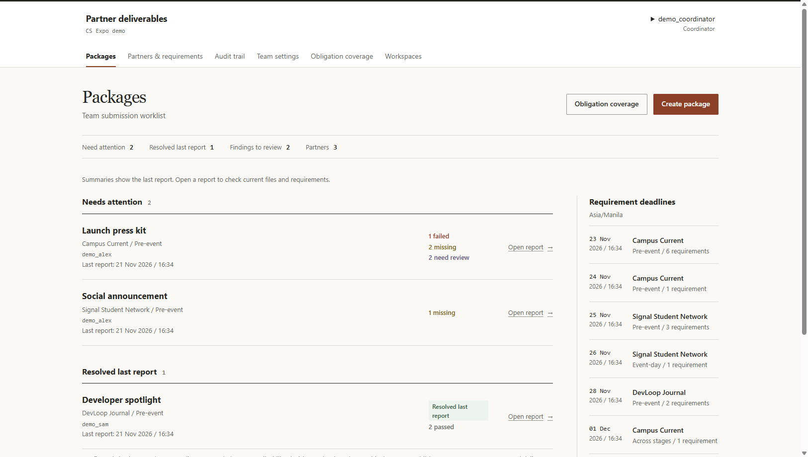
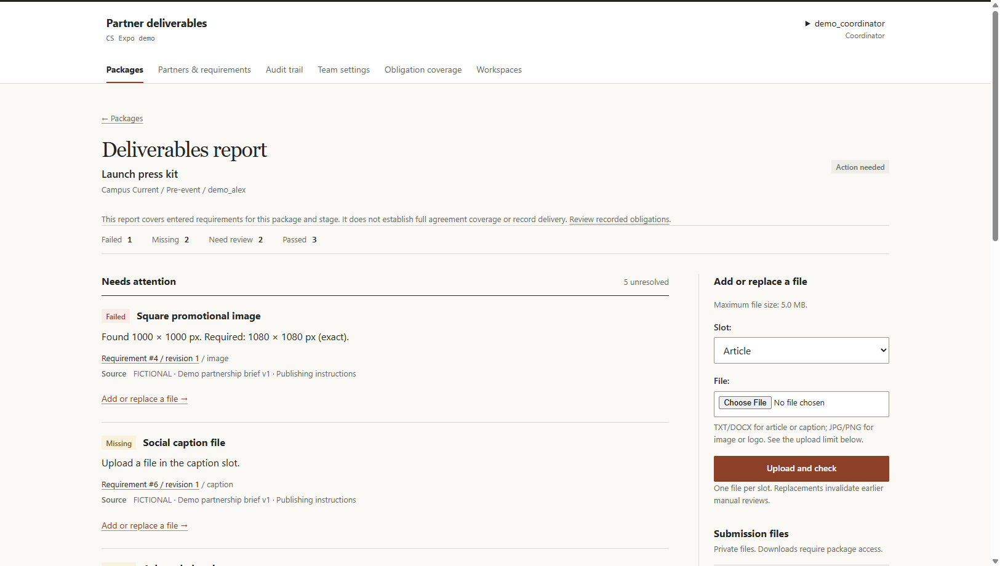
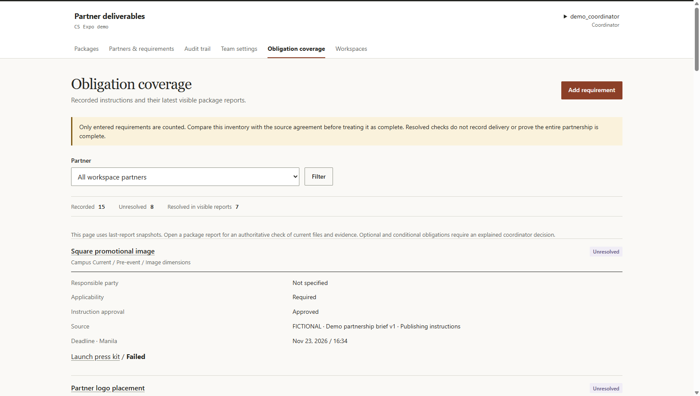
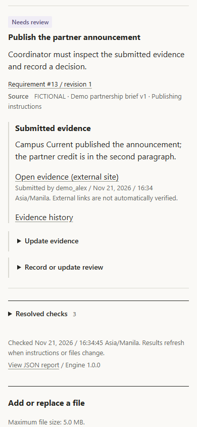
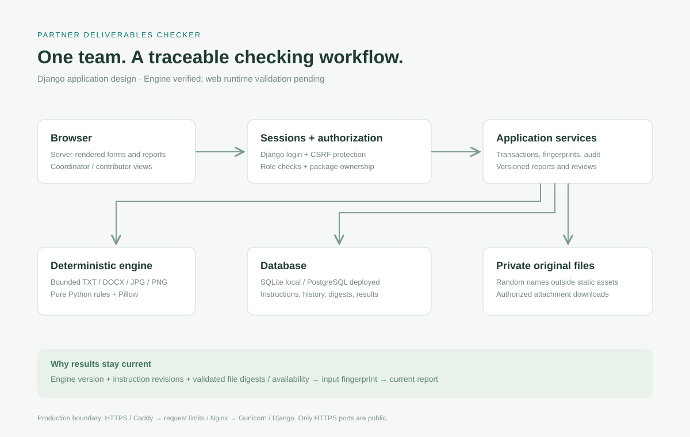

# Partner Deliverables Checker

[](https://github.com/jersonbautistadev/partner-deliverables-checker/actions/workflows/ci.yml)

A Django web app that helps a student event team keep track of what it owes its
media partners, and what they owe in return, before, during and after the event.

Teams running sponsorships juggle agreements full of obligations: "publish a 300–500
word press release mentioning the event", "place the partner logo on all publicity",
"screen the partner's video if they send one". Those obligations usually live in a
spreadsheet where a "Done" cell is the only proof. This app turns each obligation into
a tracked requirement that is either **checked automatically** (word counts, required
phrases, exact image dimensions, required files) or **reviewed by a coordinator**
against submitted evidence, with every decision tied to the exact inputs it covered.

**Live pilot:** https://partner-deliverables-checker-puux.vercel.app. This is a small,
real deployment used by one event team; new workspaces are capped while it is a pilot. To try
it with fictional data, [run it locally](#run-it-locally) and seed the demo.

| Worklist | Package report |
| --- | --- |
|  |  |
| **Obligation coverage** | **Evidence review (phone)** |
|  |  |

<sub>Screenshots use the fictional seeded demo; no real partner data is shown.</sub>

## What it does

- **Requirements with sources.** Each requirement records the partner, the event stage
  (pre-event, event-day, post-event or across all stages), who is responsible, whether
  it is required, optional or conditional, and the source it was transcribed from.
  Edits keep a revision history with the reason for the change.
- **Automatic file checks.** Upload TXT/DOCX/JPG/PNG files and get deterministic
  findings: inclusive word bounds, normalized phrase matching, exact pixel dimensions,
  required files. Uploads are content-validated, not just extension-checked.
- **Evidence and coordinator review.** For work that happens elsewhere (a published
  article, a social post, an email exchange), contributors submit an HTTPS link and an
  explanation. A coordinator records an explained pass, fail or "not applicable"
  decision. Evidence history is append-only.
- **Coverage, not just checklists.** The coverage page shows every recorded obligation
  across packages and stages, and keeps anything unproven visibly unresolved.
- **Teams and roles.** Private workspaces, email-verified accounts, invitations, and
  coordinator/contributor roles per workspace.

## Engineering highlights

- **Decisions can't go stale silently.** Every report is keyed by a SHA-256
  fingerprint of its requirements, files and evidence. A manual review is bound to a
  per-requirement key covering only the input it inspected, so replacing a poster
  invalidates the logo review on that poster but not unrelated reviews.
- **Tenant isolation in the query, not the template.** Every package, report, download
  and API route goes through one permission-filtered queryset; other workspaces' IDs
  return 404. Superusers get no cross-workspace bypass.
- **Pure, testable rules engine.** `checker/engine.py` takes plain dictionaries and
  returns findings, with no database or request access, so boundary cases are fast to
  test and easy to explain.
- **Concurrency-safe writes.** Uploads, evidence submissions, quotas and the
  "last coordinator" guard use row locks; races are tested against real PostgreSQL.
- **Private files.** Originals are stored outside static assets and served only as
  authorized attachments or 60-second signed URLs.
- **Recoverable by design.** Encrypted backups bundle the database *and* referenced
  original files, are copied off-site nightly, and have been restored into fresh
  databases with download checksums verified.
- **Durable email queue.** Verification, invitations and resets go through a database
  queue with bounded retries, so a slow mail server never blocks a request.

More in [engineering decisions](docs/engineering-notes.md) and the
[case study](docs/case-study.md).

## Tech stack

Python 3.12 · Django 5.2 (server-rendered templates, plain CSS) · PostgreSQL 17
(SQLite for local development) · Pillow · S3-compatible private storage ·
GitHub Actions · Vercel (production) or Docker Compose with Nginx and Caddy.

## Architecture



`Workspace` → `Partner` → `Requirement` / `Package`. Packages own files, evidence and
reports; requirements own their revision history. Views stay thin: services in
`checker/services.py` run each write and its audit event in one transaction, and call
the engine for findings. Details: [architecture](docs/architecture.md),
[how it works](docs/how-it-works.md), [API](docs/api.md).

## Run it locally

Requires Python 3.12. From the repository root (PowerShell shown; use `.venv/bin/python`
on macOS/Linux):

```powershell
py -3.12 -m venv .venv
.\.venv\Scripts\python -m pip install --require-hashes -r requirements.lock
.\.venv\Scripts\python manage.py migrate
.\.venv\Scripts\python manage.py seed_demo      # fictional data, empty dev database only
.\.venv\Scripts\python manage.py runserver
```

Sign in at http://127.0.0.1:8000/ as `demo_coordinator` (coordinator) or `demo_alex`
(contributor) with the development-only password `seed_demo` prints. Seeding is refused
outside debug mode. To create your own account instead, sign up and deliver the
verification email to the local file mailbox with `manage.py send_mail_queue --once`.

## Tests and checks

180 automated tests cover the rules engine, permissions and tenant isolation,
account and invitation flows, evidence and review lifecycle, concurrency races,
migrations and encrypted backup/restore. CI runs on every push:

- Ruff, Django system checks, migration consistency and a dependency vulnerability audit
- the full suite on SQLite and again on PostgreSQL 17 (row-lock races and real `pg_dump` restores)
- production deployment checks and container builds

```bash
python -m pip install -r requirements-dev.txt
python -m ruff check .
python manage.py test
```

## Status and limitations

This is a pilot for one event team, not a general product:

- Evidence links are reviewed by people; the server never fetches them, and it can't
  verify follower counts, publication, or logo placement on its own.
- Uploads are content-validated but not malware-scanned.
- It runs on free hosting tiers with small workspace, storage and email caps.

See [security scope](docs/security.md) for the full list.

## Documentation

| Topic | Document |
| --- | --- |
| How requirements, checks, evidence and permissions behave | [how-it-works.md](docs/how-it-works.md) |
| Architecture and data model | [architecture.md](docs/architecture.md) |
| Design decisions and trade-offs | [engineering-notes.md](docs/engineering-notes.md) |
| Case study | [case-study.md](docs/case-study.md) |
| Security scope | [security.md](docs/security.md) |
| Deployment, operations, backups | [deployment.md](docs/deployment.md), [operations.md](docs/operations.md), [offsite-backups.md](docs/offsite-backups.md) |
| JSON API | [api.md](docs/api.md) |
| Dated verification and release records | [docs/records/](docs/records/README.md) |
