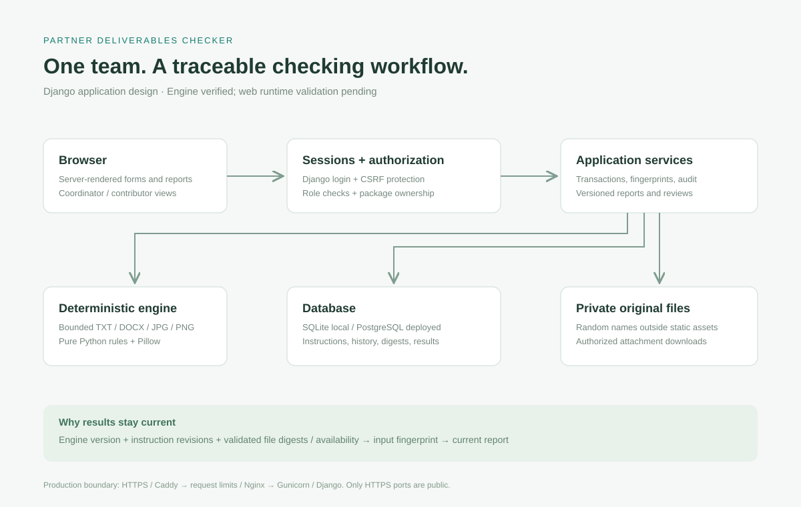
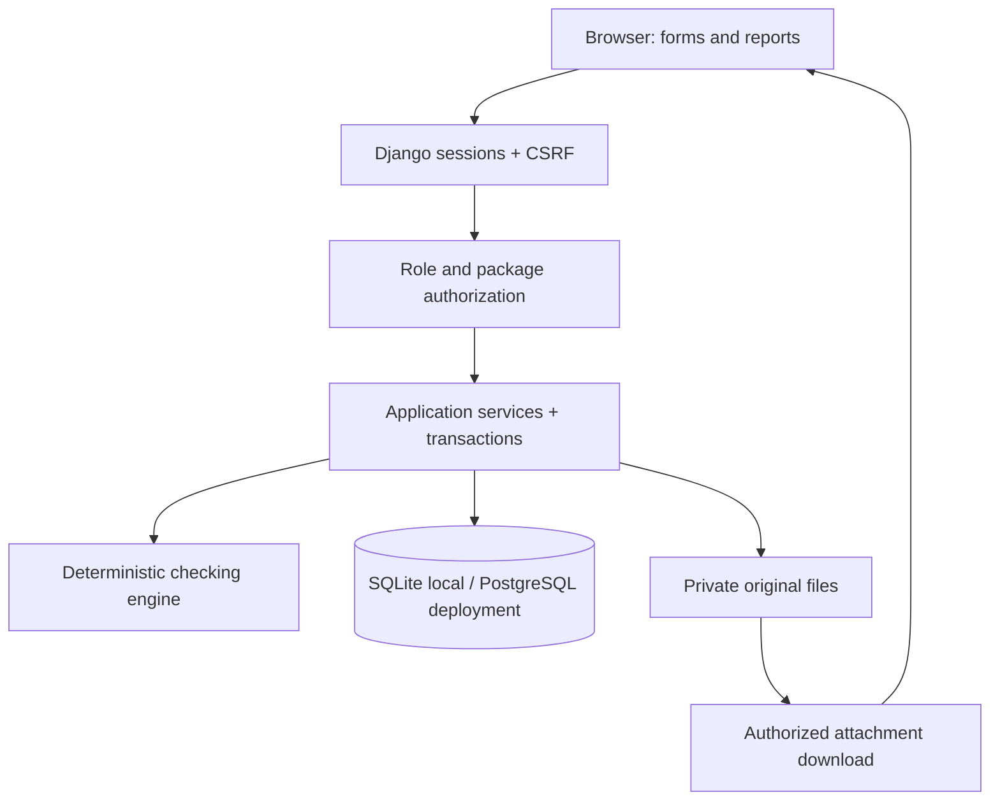
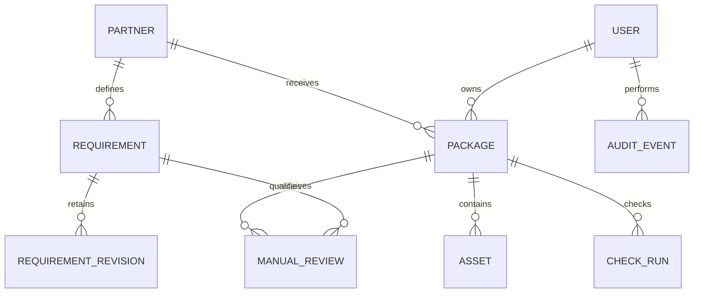

# Architecture

One application and one event team. Business rules are plain Python functions, independent of web requests and persistence.

The production network is HTTPS → Caddy → Nginx → Gunicorn/Django. Caddy manages TLS. Nginx caps request bodies and limits login requests. Only Caddy publishes host ports. Neither proxy serves private files. WhiteNoise serves collected CSS only.

Requirements and packages both carry a submission stage. A pre-event package uses only that partner's pre-event instructions. Each current asset occupies one unique `(package, slot)` pair. Requirement revisions are unique by `(requirement, number)`. Foreign-key protection prevents accidentally removing referenced partners, requirements or users through the ORM.

The current report is a retained check run keyed by a SHA-256 fingerprint of engine version, current requirement snapshots and validated asset metadata/content digests/availability. Requirements include approval state, source, revision and deadline. Replacing an asset includes its new record ID, conservatively invalidating even a same-content replacement. Manual reviews reference this exact fingerprint; old decisions stay in history but do not apply after inputs change.

Writes create the change and its audit event in the same database transaction. Package operations lock the package row in PostgreSQL. New file writes are cleaned up if their database transaction fails; replaced/removed files are deleted after commit. A process crash between storage and database operations can still leave orphaned files; reconciliation is a deployment follow-up.

No task queue, separate API server, frontend framework, tenant layer or external service is needed in v1. Reports run synchronously because each package has at most four bounded files and uses pre-extracted metadata. A queue becomes useful only if measured workload justifies it.
